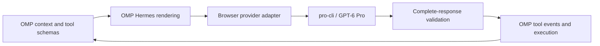

# GPT-6 Pro as a coding-harness provider

Investigated September 5, 2026 using the installed Oh My Pi (OMP) 17.3.3 and
the user's authenticated ChatGPT browser session. The prediction drill tested
the integration boundary with disposable fixtures and temporary conversations.

**Yes: GPT-6 Pro can drive the OMP agent loop.** A live prototype used the real
installed `@oh-my-pi/pi-agent-core` package to request a file read, request an
edit, invoke verification, and consume the resulting tool output. This proves
a bounded tool loop. It does not establish reliability on large repositories
or install an everyday OMP provider.

## What was demonstrated

The fixture contained an `add` function returning `a - b`. Three local tools
could read that one file, replace that expression with `a + b`, and execute
checks for `add(2, 3) === 5` and `add(-1, 1) === 0`. The edit tool deliberately
restricted the allowed replacement. A random file marker had to survive, and
verification generated a fresh random token that the final answer had to quote.
This tests protocol operation and actual tool-result consumption, rather than
general coding ability. The fixture was deleted afterward.

The first live run completed the sequence in four Pro calls, taking 36.361,
15.910, 13.462, and 23.784 seconds (89.517 seconds total provider time). Each
turn replayed the harness transcript in a new temporary ChatGPT conversation.
No saved conversation IDs were needed.

A separate synthetic extension loaded into the actual `omp` CLI and returned
`REGISTERED:pro-browser-registration-probe/gpt-6-pro`. It used a temporary
configuration directory and explicit model selection. This checks extension
registration; the live coding test exercised OMP's Agent core, not the full
interactive UI, built-in editing tools, or subagent launcher.

## The integration seam

OMP exposes `registerProvider({ api, models, streamSimple, ... })` for custom
transports. Its SDK also supports `tools.format: hermes`. With that format,
`prepareProviderCall` renders tool schemas into the prompt and rewrites prior
tool calls/results as text. `wrapInbandToolStream` converts returned tool-call
text into the normal OMP events. OMP's existing dispatcher then resolves tools,
validates arguments, executes them, and feeds the results into the next turn.
See [OMP provider documentation](https://github.com/can1357/oh-my-pi/blob/main/docs/providers.md)
and its [in-band converter documentation](https://github.com/can1357/oh-my-pi/blob/main/docs/toolconv/qwen3.md).

`pro-cli` currently accepts a prompt and returns completed text. It buffers the
browser SSE response with `response.text()` and builds one browser `user`
message; it does not expose an OpenAI-compatible messages/tools endpoint.
The prototype serialized OMP's system instructions and transcript into that
prompt, then returned a completed text stream to OMP. Those role labels remain
text inside a ChatGPT user message, so API-level role priority is not preserved.
The ChatGPT application's own instructions and behavior still apply.

OMP's existing ChatGPT/Codex login is a separate route. Its provider uses
`/codex/responses`; `pro-cli` uses `/backend-api/f/conversation`. Existing Codex
subscription support does not by itself make the browser's `gpt-6-pro` model
available through that provider. The custom browser adapter must select and
verify the browser model explicitly.

## Problems the drill found

| Boundary | Observation | Needed behavior |
| --- | --- | --- |
| Tool parsing | OMP interpreted a valid tool frame inside a quoted code example as a call. An unfinished call to a tool with no required arguments also executed in the synthetic probe. | Validate the entire response before handing any tool frame to OMP. Reject incomplete frames and tool syntax mixed with explanatory prose/code fences. |
| Tool arguments | OMP rejected missing required arguments before execution. `pro-cli`'s `validateLightly` checks only root type and required fields. | Retain the harness's tool-schema validation; do not treat CLI structured output as an execution validator. |
| Repair loops | Repeated truncated frames retriggered the loop until the probe's five-request cap. | Limit protocol repairs and total requests per user task. Never automatically resend indefinitely. |
| Cancellation | A local abort prevented later tool execution. The browser transport has no request-scoped abort interface; `job cancel` changes local state only. | Connect cancellation to a specific browser request and distinguish local cancellation from confirmed server-side stop. |
| Latency/streaming | A tiny four-turn task took about 90 seconds in the first live run; text arrived after each browser response finished. | Expose real progress for long turns and measure realistic workloads before choosing Pro for every tool iteration. |
| Context and usage | Full history is replayed per turn, and the transport does not return trustworthy token-usage accounting to the harness. | Use explicit estimates and conservative context limits; validate compaction, forks, and long tool output. The probe's zero usage/cost fields are placeholders, not measurements. |

The temporary adapter was then changed to accept either ordinary text without
tool tags or a sequence of complete top-level tool frames. It parses each JSON
object strictly before emitting anything, requires closing tags, and re-encodes
literal `<` characters inside arguments as JSON Unicode escapes so code strings
cannot prematurely close the dialect frame. OMP still owns argument validation
and tool execution.

With that guard, malformed frames, truncated no-argument calls, and quoted
examples produced zero tool executions and stopped after one provider attempt.
The valid synthetic read/edit/verify loop still completed. Unknown tool names
and missing required arguments remained harness errors. This closes the
specific reproduced failures; it does not prove resistance to every ambiguous
model output or hostile repository instruction.

The original live fixture was repeated with the guard enabled. It again
completed read/edit/verify/final in four GPT-6 Pro requests, this time taking
14.692, 15.564, 14.872, and 31.121 seconds (76.249 seconds total provider time).
The final answer consumed a newly generated verification token. Both live
runs used temporary chats; all fixture directories were removed afterward.

## Recommended next implementation

Build a small OMP extension around the existing browser transport and explicitly
select the tested Hermes format. Keep OMP responsible for file operations,
approval rules, transcript storage, and tool validation. The browser adapter
should own request serialization, full-response validation, model/effort
selection, request identity, cancellation, and bounded retry behavior.

Start with serialized requests and a conservative context budget. Test a real
multi-file task with the built-in read/edit/test tools, then interruption,
compaction, restart, and model selection in child sessions. Those remain
unverified. A portable OpenAI-compatible gateway is a subsequent option if a
second harness needs the same transport; OMP's extension seam does not require
one.

Pro can also be used immediately as an advisor from a harness's terminal tool
through `pro-cli ask` or durable jobs. The prototype establishes that a primary
model integration is technically possible too, with the transport and parsing
work above still required for daily use.

The disposable probe is retained locally at `/tmp/pro-omp-feasibility.ts` for
review. `--live` sends real Pro requests; its default and failure-test modes use
synthetic responses. No browser cookies or tokens are embedded in it, and no
global OMP configuration or installed package was changed.
